# Atlas

Point it at a repository, get one HTML file that maps the code: a circle of areas, files and functions with the
calls between them, rings sized by lines of code, and the source one click away. The file works offline and is
the same for anyone who builds the same commit.

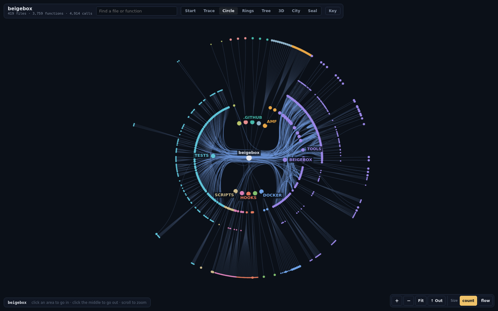

    python3 -m venv .venv && .venv/bin/pip install -r requirements.txt
    .venv/bin/python -m atlas PATH -o atlas.html

Parsing is cached by file content in `~/.cache/atlas`, so a rebuild only reads files that changed.

| Part | Job |
|---|---|
| `atlas/readers.py` | tree-sitter readers: definitions, calls, imports for Python, JS/TS, Go, Rust, C/C++, Java, Kotlin, shell |
| `atlas/scan.py` | lists the files (git or a walk), skips vendored and generated code, caches parses |
| `atlas/graph.py` | resolves calls, places files into areas, tests and test reach, entry points |
| `atlas/infra.py` | what runs and how to run it: systemd, Docker, compose, package.json, Makefile, pyproject, Cargo, go.mod |
| `atlas/page.py` | writes the single file: the app plus gzip data blocks (source per area, unpacked on demand) |
| `web/app.js` | the core: model, Circle and Rings on a canvas, side panel with code, search, view switching |
| `web/views/` | Start, Trace, Tree, City and Seal, 3D planes, AI notes (stitched into the page at build time) |
| `web/prompts.json` | the AI prompts and the answer format; shared with a future command-line `explain` step |
| `web/vendor/` | three.js r147 (MIT), stored in the page and loaded only when 3D opens |

Views:

- **Start**: how to read the repo. *When you turn the key* follows the command (compose, Dockerfile CMD, systemd
  unit, package `bin`, pyproject script) to the code and through it in order, then where the work happens, where it
  leaves the program (network, database, subprocess, waits), and the types the most files use.
- **Trace**: follow a program, request, function, file, or a piece of pasted text (an error message) call by call,
  with caller and callee code side by side.
- **Circle**: areas, files and functions on a circle with bundled call curves; double-click to fold anything, size by
  count or by flow (how many front doors pass through).
- **Rings**, **Tree**, **3D** (one plane per level; play a walk through it), **City** (a treemap) and **Seal**
  (test coverage read from the calls: what a test exercises, which tests reach a function).

Screenshots (all of [beigebox](https://github.com/RALaBarge/beigebox), built with no AI):

| | |
|---|---|
| 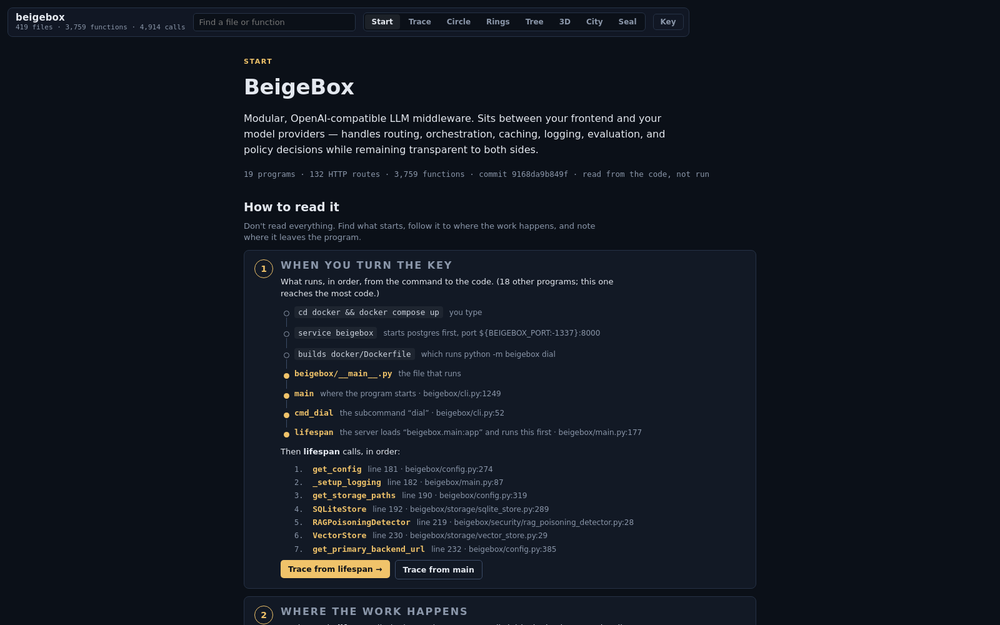 **Start**: the command-to-code chain | 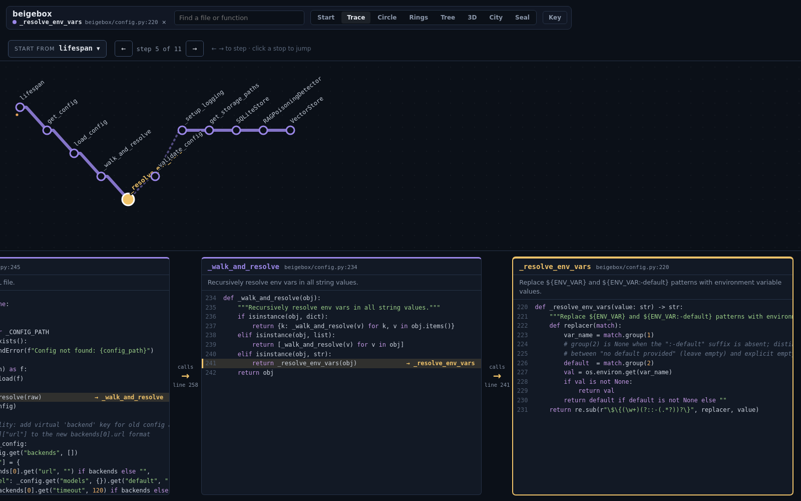 **Trace**: a path, caller and callee code side by side |
| 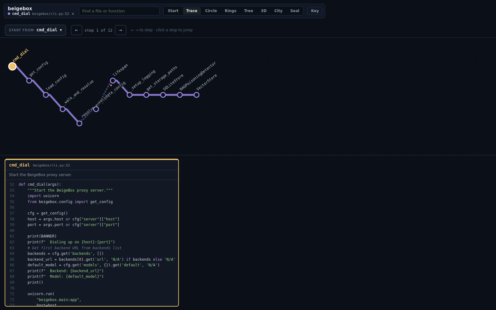 **Trace** from pasted text (`Dialing up`) | 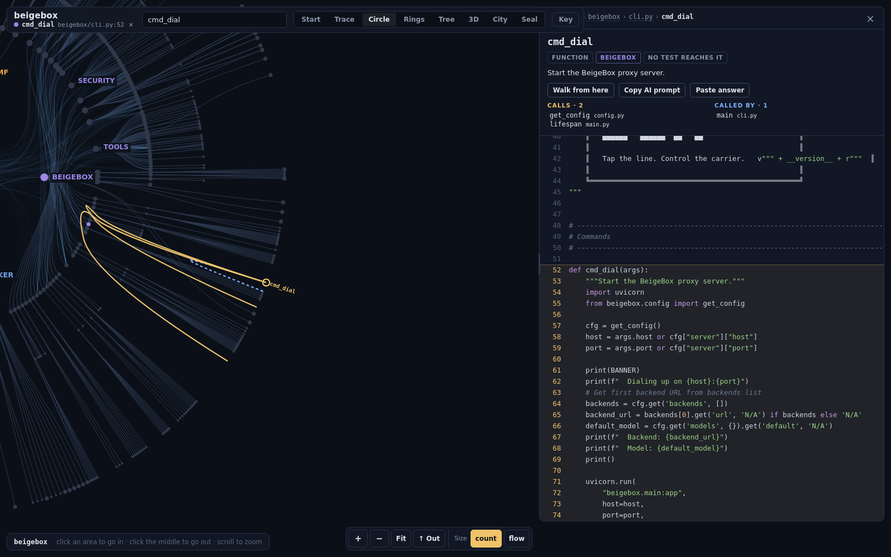 **Circle**: a function's calls (gold out, blue in) |
| 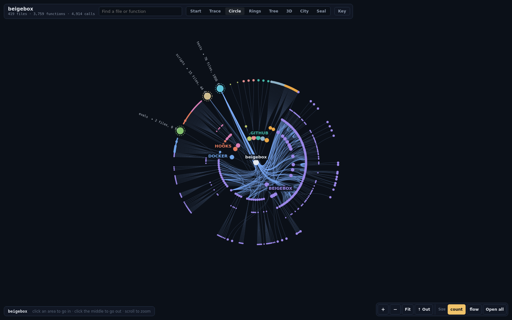 **Circle** with tests, scripts and evals folded | 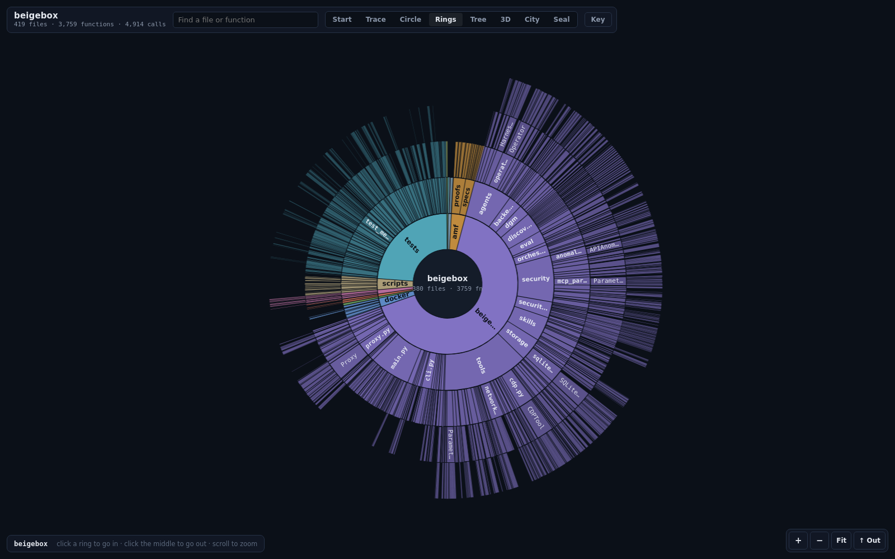 **Rings**: sized by lines of code |
| 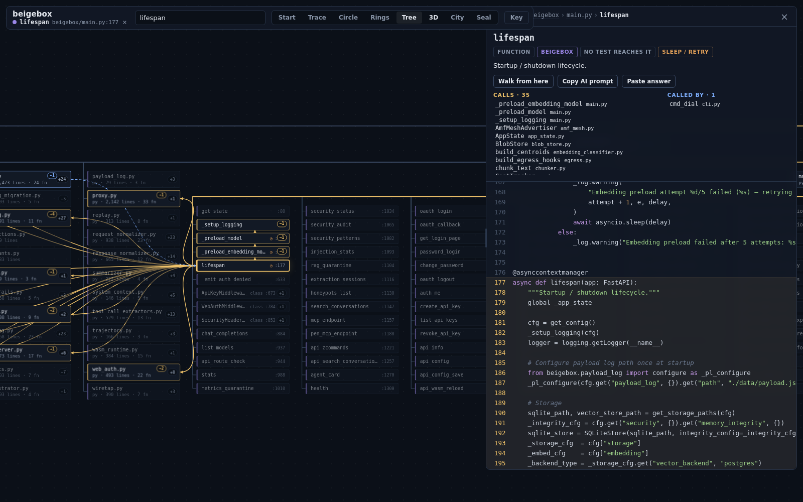 **Tree** with a selection | 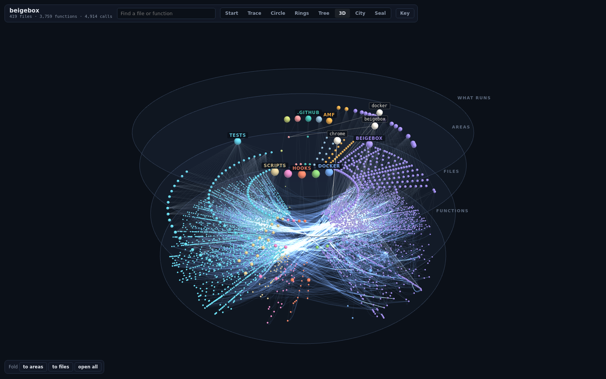 **3D**: one plane per level |
| 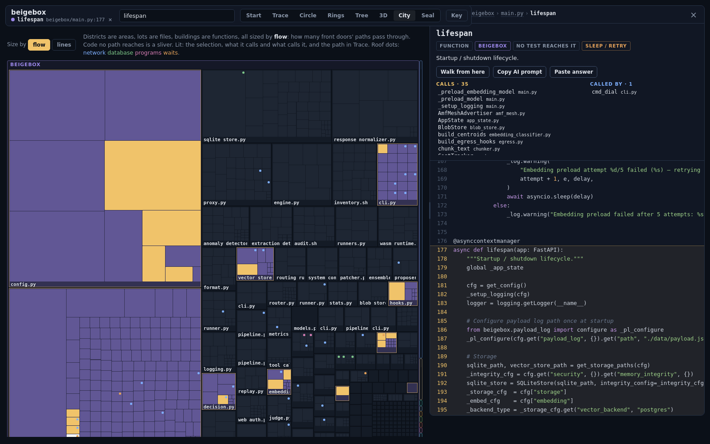 **City**: sized by flow, selection lit | 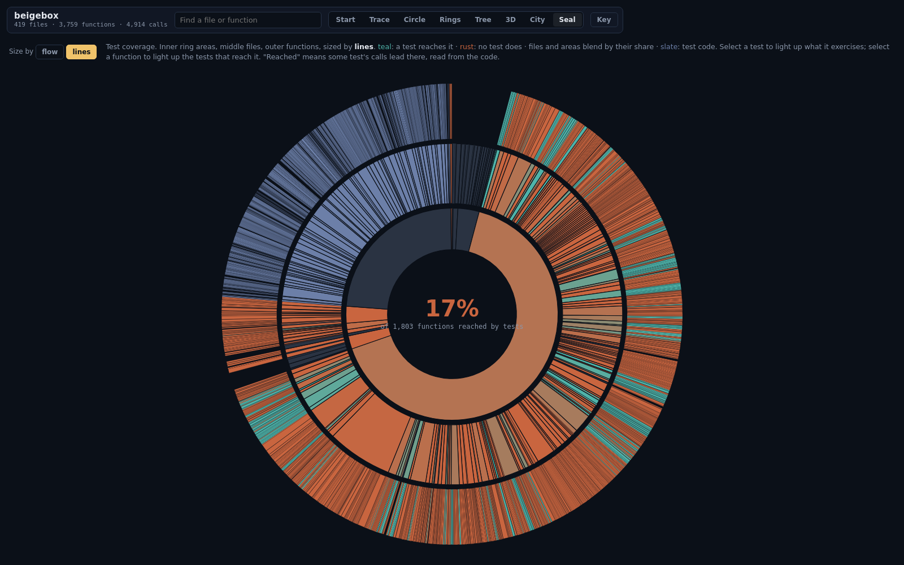 **Seal**: 17% of functions reached by a test |
| 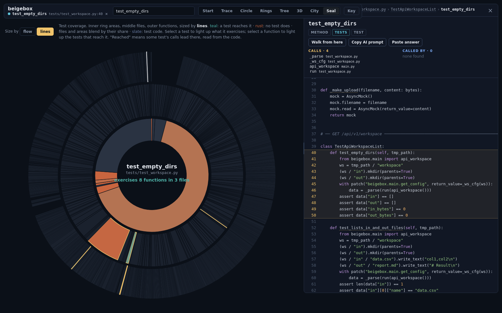 **Seal**: what one test exercises | |

Whatever you select stays selected across views and is named in the top bar.

AI is optional: "Copy AI prompt" on a function or walk, paste the answer back; it is checked (shape, real ids, known
tags) and kept per browser. Nothing in the map comes from AI.

Very large repos: `--split` keeps the map in the page and writes the source text beside it as `atlas-src-N.txt`
files, fetched when you open code (serve the folder; browsers won't fetch next to a `file://` page).

Calls are found by reading the code. A call through a function value, a dynamic dispatch the reader can't see, or
another language is missing; an ambiguous call is left out rather than guessed.
